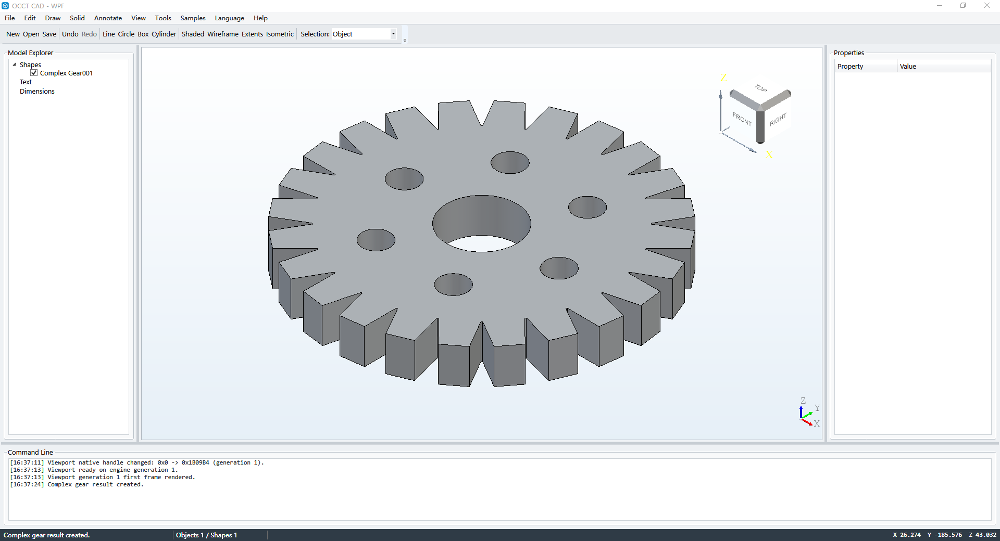
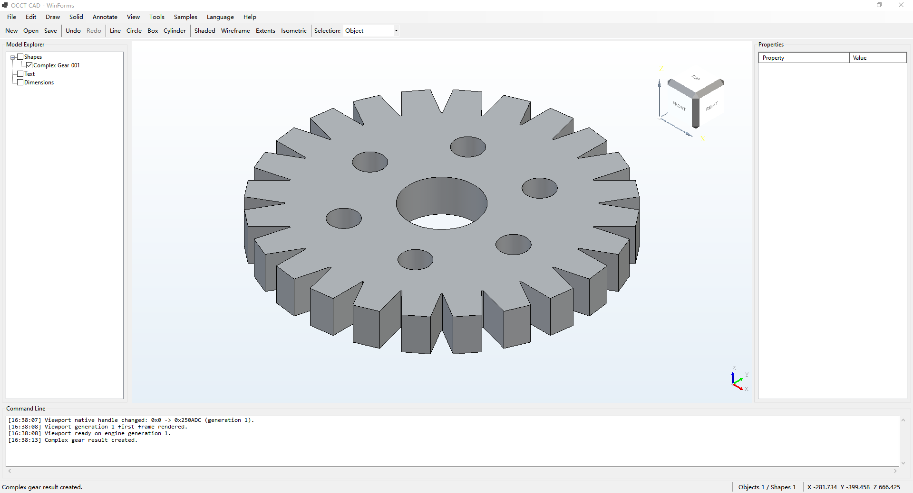
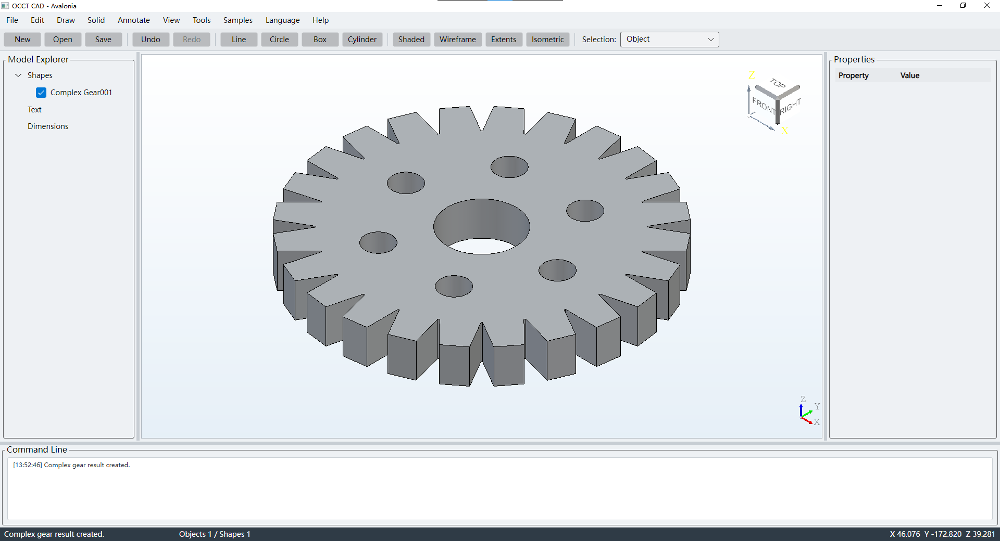
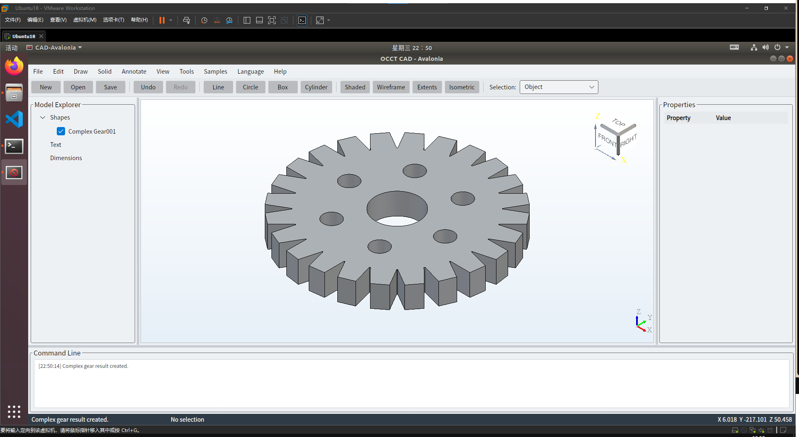

<p align="center">
  
</p>

<h1 align="center">OcctCSharpBridge</h1>

<p align="center">Reusable Open CASCADE Technology 7.9.0 to .NET bridge for CAD, BIM, and engineering applications.</p>

<p align="center">
  <a href="./README.md">English</a> | <a href="./README.zh-CN.md">简体中文</a>
</p>

<p align="center">
      <a href="./docs/en-US/README.md"></a> <a href="./LICENSE"></a>
</p>

OcctCSharpBridge 3.0 exposes Open CASCADE Technology (OCCT) 7.9.0 through a versioned ABI 5 native C boundary (`OcctNative`) and strongly typed .NET assemblies (`OcctNet`, `OcctNet.WinForms`, `OcctNet.Wpf`, and `OcctNet.Avalonia`). It stays strictly at the low-level geometry, modeling, and viewer layer—documents, feature trees, commands, undo/redo, snapping, grips, domain catalogs, and project persistence remain the responsibility of consuming applications.

## Highlights

| Highlight | Why it matters |
| --- | --- |
| Versioned ABI 5 native boundary | Isolates OCCT 7.9.0 C++ internals in `OcctNative` behind a clean ABI 5 C contract (`current = 5`, `minimumSupported = 5`). |
| Multi-target .NET 8 / 9 / 10 support | Built with stable .NET 10 SDK (`10.0.100+`) while targeting `.NET 8`, `.NET 9`, and `.NET 10` x64 consumer applications. |
| Independent UI viewport adapters | Ships dedicated `OcctNet.WinForms`, `OcctNet.Wpf`, and `OcctNet.Avalonia` hosts that depend only on `OcctNet` and never on each other. |
| Deterministic first-frame readiness | WPF and Avalonia `HostState == Ready` guarantees a valid native surface size with at least one completed `ResizeSurface + Redraw`, removing startup timer or pointer-move workarounds. |
| Headless modeling and exchange | Separates geometry, topology, mesh, and STEP/OBJ/glTF exchange from Viewer/AIS state for CLI, service, and background pipelines. |

## Architecture

`OcctNet` owns strongly typed managed semantics, `OcctNative` owns the C++/OCCT boundary, and UI adapters remain isolated from each other.

```text
┌────────────────────────────────────────────────────────────────────┐
│                       Consuming Application                        │
│        (Documents, Feature Trees, Commands, Undo/Redo, UI)         │
└───────────┬───────────────────────┬───────────────────────┬────────┘
            │                       │                       │
            ▼                       ▼                       ▼
┌───────────────────┐   ┌───────────────────┐   ┌────────────────────┐
│ OcctNet.WinForms  │   │    OcctNet.Wpf    │   │  OcctNet.Avalonia  │
│     (Windows)     │   │     (Windows)     │   │ (Windows / Linux)  │
└─────────┬─────────┘   └─────────┬─────────┘   └─────────┬──────────┘
          │                       │                       │
          └───────────────────────┼───────────────────────┘
                                  ▼
┌────────────────────────────────────────────────────────────────────┐
│                         OcctNet (Managed)                          │
│  Core | Geometry | Modeling | Topology | Mesh | Exchange | Viewer  │
└─────────────────────────────────┬──────────────────────────────────┘
                                  │ ABI 5 C API (P/Invoke)
                                  ▼
┌────────────────────────────────────────────────────────────────────┐
│                     OcctNative (C++ Native Core)                   │
│            OcctNative.dll (Win x64) / libOcctNative.so             │
└─────────────────────────────────┬──────────────────────────────────┘
                                  │
                                  ▼
┌────────────────────────────────────────────────────────────────────┐
│               Open CASCADE Technology (OCCT 7.9.0)                 │
└────────────────────────────────────────────────────────────────────┘
```

For domain directory ownership and headless boundary rules, see [Architecture and Boundaries](./docs/en-US/02_Architecture-and-Boundaries.md).

## Usage Example

### Demo Previews

The [demo](https://github.com/zly258/OcctCSharpBridge/tree/demo) branch contains unified reference hosts for WinForms, WPF, and Avalonia (Windows x64) and Avalonia (Linux x64) consuming the generated Bridge SDK without duplicating Bridge internals.

| Windows WPF | Windows WinForms |
| --- | --- |
|  |  |

| Windows Avalonia | Linux Avalonia |
| --- | --- |
|  |  |

## Quick Install

### Supported baseline

| Item | Value |
| --- | --- |
| Bridge | `3.0.0` |
| Native ABI | `5` only (`abi5-only`) |
| OCCT | `7.9.0` |
| Build SDK | Stable .NET 10 (`10.0.100+`, `rollForward=latestFeature`) |
| Managed targets | `.NET 8` / `.NET 9` / `.NET 10` (`x64`) |
| Windows UI | WinForms / WPF / Avalonia |
| Linux UI | Avalonia (source build) |
| Official prebuilt | Windows x64 |

`bridge-contract.json` is the machine-readable build and distribution contract.

### Prerequisites

- Open CASCADE Technology **7.9.0** (`x64`)
- **CMake 3.21+** and a C++ toolchain (MSVC on Windows; GCC/Clang on Linux)
- **Stable .NET 10 SDK** (`10.0.100` or later 10.0 feature band)

### Build and install

**Windows x64 — build only:**

```powershell
.\build.ps1 build Release -OcctRoot "D:\tools\occt-vc144-64"
```

**Windows x64 — install or update the shared SDK:**

```powershell
.\publish.ps1 -OcctRoot "D:\tools\occt-vc144-64"
```

Default SDK install root: `C:\Program Files\OcctCSharpBridge\SDK\3.0\win-x64`. Override with `OCCTCSHARPBRIDGE_SDK` or `-InstallRoot`. Windows consumer projects reference this installed SDK directly; no synchronized copy inside consumer repositories is required.

**Linux x64 — source build:**

```bash
./build.sh build Release
```

Generated `dist/`, `artifacts/`, portable SDKs, and release archives are build outputs and are not committed to source branches.

## Quick Start

### 1. Reference the SDK in your `.csproj`

```xml
<PropertyGroup>
  <OcctBridgeSdkRoot Condition="'$(OCCTCSHARPBRIDGE_SDK)' != ''">$(OCCTCSHARPBRIDGE_SDK)</OcctBridgeSdkRoot>
  <OcctBridgeSdkRoot Condition="'$(OcctBridgeSdkRoot)' == ''">$(ProgramFiles)\OcctCSharpBridge\SDK\3.0\win-x64</OcctBridgeSdkRoot>
</PropertyGroup>

<ItemGroup>
  <Reference Include="OcctNet">
    <HintPath>$(OcctBridgeSdkRoot)\OcctNet.dll</HintPath>
    <Private>true</Private>
  </Reference>
</ItemGroup>
```

Add `OcctNet.WinForms.dll`, `OcctNet.Wpf.dll`, or `OcctNet.Avalonia.dll` when embedding an interactive 3D viewport.

### 2. Run a minimal headless modeling session

```csharp
using OcctNet;

OcctRuntime.Configure();

using var model = new OcctModelingSession();
var plate = model.MakeBox(100, 80, 10);
var hole = model.MakeCylinder(new OcctPoint3d(50, 40, -5), OcctVector3d.UnitZ, 8, 20);
var cut = model.Cut(plate, hole);
model.ExportStep(cut.Shape, "plate.step");
```

This initializes the native runtime, constructs a `100 x 80 x 10` plate, subtracts a vertical through-hole cylinder of radius `8`, and exports the resulting solid to `plate.step`.

When using WPF or Avalonia viewports, add the control to the visual tree normally and wait for `HostState == Ready` if startup logic depends on the first presented native frame.

## Documentation

| Topic | What it covers | Link |
| --- | --- | --- |
| Documentation index | Full Bridge 3.0 contract and guide overview | [docs/en-US/README.md](./docs/en-US/README.md) |
| Getting started | SDK selection, references, and minimal consumer setup | [01_Getting-Started.md](./docs/en-US/01_Getting-Started.md) |
| Architecture and boundaries | Layering, domain ownership, and headless rules | [02_Architecture-and-Boundaries.md](./docs/en-US/02_Architecture-and-Boundaries.md) |
| API coverage and conventions | Managed API organization and design rules | [03_API-Coverage-and-Design-Conventions.md](./docs/en-US/03_API-Coverage-and-Design-Conventions.md) |
| Geometry, modeling, and topology | Modeling session, topology queries, and analysis | [04_Geometry-Modeling-and-Topology.md](./docs/en-US/04_Geometry-Modeling-and-Topology.md) |
| Viewer, selection, and interaction | Viewport host lifecycle and interaction contracts | [05_Viewer-Selection-and-Interaction.md](./docs/en-US/05_Viewer-Selection-and-Interaction.md) |
| Mesh and data exchange | Triangulation and STEP/OBJ/glTF exchange boundaries | [06_Mesh-and-Data-Exchange.md](./docs/en-US/06_Mesh-and-Data-Exchange.md) |
| Runtime deployment and diagnostics | Native/OCCT runtime loading and troubleshooting | [07_Runtime-Deployment-and-Diagnostics.md](./docs/en-US/07_Runtime-Deployment-and-Diagnostics.md) |
| Build, test, and publish | Build scripts, Windows Stable gate, and Linux validation | [08_Build-Test-and-Publish.md](./docs/en-US/08_Build-Test-and-Publish.md) |
| Third-party SDK consumption | External Core, WinForms, WPF, and Avalonia integration | [09_Third-Party-SDK-Consumption.md](./docs/en-US/09_Third-Party-SDK-Consumption.md) |
| Stable support and compatibility | Platform, .NET, ABI, threading, and lifetime policies | [10_Stable-Support-and-Compatibility.md](./docs/en-US/10_Stable-Support-and-Compatibility.md) |
| Build contract | Machine-readable version, ABI, and target metadata | [bridge-contract.json](./bridge-contract.json) |

## License

OcctCSharpBridge is licensed under the **GNU Lesser General Public License version 2.1 (LGPL-2.1)** with the **OcctCSharpBridge Exception 1.0**.

- Full terms: [LICENSE](./LICENSE), [LICENSE_LGPL_21.txt](./LICENSE_LGPL_21.txt), and [OcctCSharpBridge_LGPL_EXCEPTION.txt](./OcctCSharpBridge_LGPL_EXCEPTION.txt)
- Commercial and proprietary use guidance: [COMMERCIAL.md](./COMMERCIAL.md)
- Third-party and OCCT 7.9.0 notices: [THIRD_PARTY_NOTICES.md](./THIRD_PARTY_NOTICES.md)
