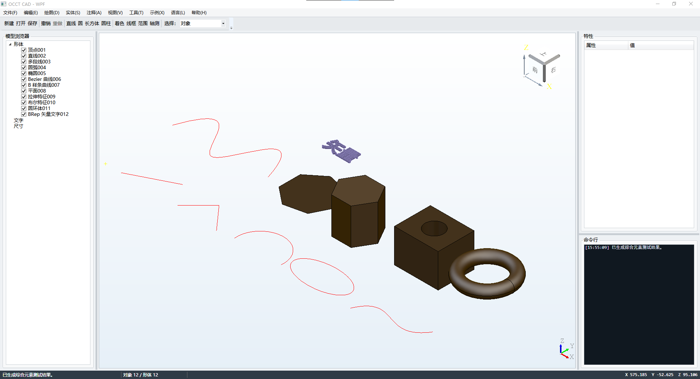
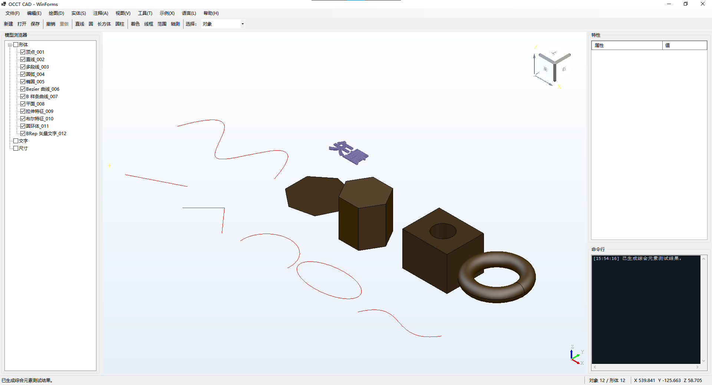
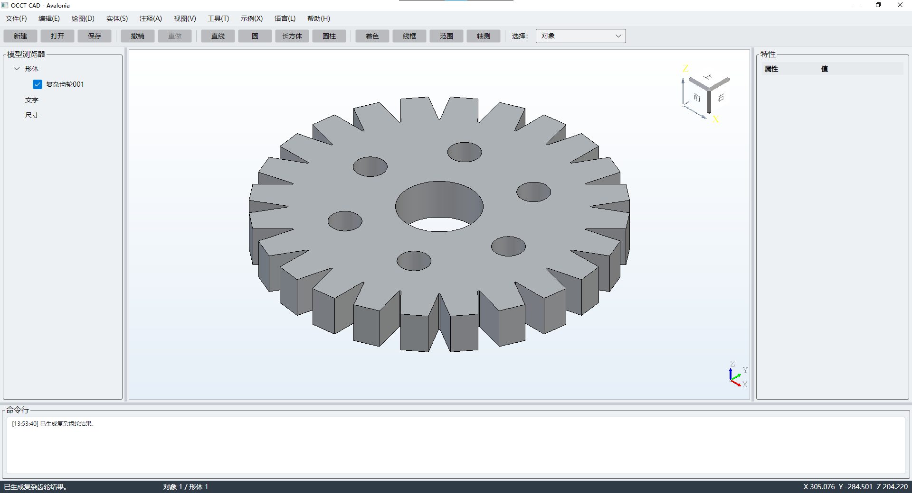
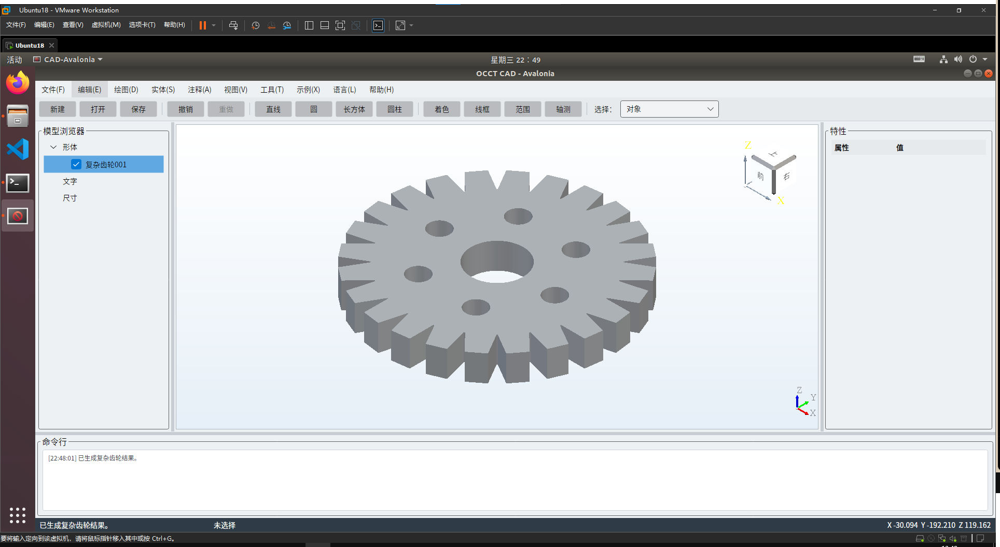

<p align="center">
  
</p>

<h1 align="center">OcctCSharpBridge</h1>

<p align="center">面向 CAD、BIM 与工程应用的 Open CASCADE Technology 7.9.0 到 .NET 可复用桥接库。</p>

<p align="center">
  <a href="./README.md">English</a> | <a href="./README.zh-CN.md">简体中文</a>
</p>

<p align="center">
      <a href="./docs/zh-CN/README.md"></a> <a href="./LICENSE"></a>
</p>

OcctCSharpBridge 3.0 通过版本化的 ABI 5 原生 C 边界（`OcctNative`）与强类型 .NET 程序集（`OcctNet`、`OcctNet.WinForms`、`OcctNet.Wpf`、`OcctNet.Avalonia`）封装 Open CASCADE Technology (OCCT) 7.9.0。项目严格保持在底层几何、建模与视图桥接层——文档模型、特征树、命令系统、撤销重做、捕捉、夹点、业务目录语义和项目持久化均归属上层应用。

## 核心特性

| 特性 | 工程价值 |
| --- | --- |
| 版本化 ABI 5 原生边界 | 将 OCCT 7.9.0 C++ 内部实现隔离在 `OcctNative` 中，对外仅暴露稳定的 ABI 5 C 契约（`current = 5`、`minimumSupported = 5`）。 |
| 多版本 .NET 8 / 9 / 10 支持 | 使用稳定版 .NET 10 SDK（`10.0.100+`）构建，面向 `.NET 8`、`.NET 9`、`.NET 10` x64 消费端应用。 |
| 独立的 UI 视图适配器 | 提供 `OcctNet.WinForms`、`OcctNet.Wpf` 和 `OcctNet.Avalonia` 宿主控件，各适配器仅依赖 `OcctNet`，互不耦合。 |
| 确定性的首帧就绪契约 | WPF 与 Avalonia 的 `HostState == Ready` 表示 Native Viewport 已具备有效尺寸并完成至少一次 `ResizeSurface + Redraw`，无需再用鼠标模拟或延时补帧。 |
| 无头建模与数据交换 | 将几何、拓扑、网格提取和 STEP/OBJ/glTF 交换与 Viewer/AIS 状态解耦，适用于命令行、服务端或后台流水线。 |

## 架构设计

`OcctNet` 负责强类型托管语义，`OcctNative` 负责 C++/OCCT 边界，各 UI 适配器彼此隔离。

```text
┌────────────────────────────────────────────────────────────────────┐
│                       Consuming Application                        │
│        (Documents, Feature Trees, Commands, Undo/Redo, UI)         │
└───────────┬───────────────────────┬───────────────────────┬────────┘
            │                       │                       │
            ▼                       ▼                       ▼
┌───────────────────┐   ┌───────────────────┐   ┌────────────────────┐
│ OcctNet.WinForms  │   │    OcctNet.Wpf    │   │  OcctNet.Avalonia  │
│     (Windows)     │   │     (Windows)     │   │ (Windows / Linux)  │
└─────────┬─────────┘   └─────────┬─────────┘   └─────────┬──────────┘
          │                       │                       │
          └───────────────────────┼───────────────────────┘
                                  ▼
┌────────────────────────────────────────────────────────────────────┐
│                         OcctNet (Managed)                          │
│  Core | Geometry | Modeling | Topology | Mesh | Exchange | Viewer  │
└─────────────────────────────────┬──────────────────────────────────┘
                                  │ ABI 5 C API (P/Invoke)
                                  ▼
┌────────────────────────────────────────────────────────────────────┐
│                     OcctNative (C++ Native Core)                   │
│            OcctNative.dll (Win x64) / libOcctNative.so             │
└─────────────────────────────────┬──────────────────────────────────┘
                                  │
                                  ▼
┌────────────────────────────────────────────────────────────────────┐
│               Open CASCADE Technology (OCCT 7.9.0)                 │
└────────────────────────────────────────────────────────────────────┘
```

领域目录归属与无头建模边界规则详见 [架构与边界](./docs/zh-CN/02_架构与边界.md)。

## 使用示例

### Demo 预览

[demo](https://github.com/zly258/OcctCSharpBridge/tree/demo) 分支提供统一的 WinForms、WPF、Avalonia（Windows x64）与 Avalonia（Linux x64）参考宿主，直接消费构建生成的 Bridge SDK，不维护第二套 Bridge 实现。

| Windows WPF | Windows WinForms |
| --- | --- |
|  |  |

| Windows Avalonia | Linux Avalonia |
| --- | --- |
|  |  |

## 快速安装

### 当前支持基线

| 项目 | 值 |
| --- | --- |
| Bridge | `3.0.0` |
| Native ABI | 仅 `5`（`abi5-only`） |
| OCCT | `7.9.0` |
| 构建 SDK | 稳定版 .NET 10（`10.0.100+`，`rollForward=latestFeature`） |
| 托管目标框架 | `.NET 8` / `.NET 9` / `.NET 10`（`x64`） |
| Windows UI | WinForms / WPF / Avalonia |
| Linux UI | Avalonia（源码构建） |
| 官方预编译平台 | Windows x64 |

`bridge-contract.json` 保存机器可读的构建与分发契约。

### 环境要求

- Open CASCADE Technology **7.9.0**（`x64`）
- **CMake 3.21+** 及 C++ 编译工具链（Windows 使用 MSVC，Linux 使用 GCC/Clang）
- **稳定版 .NET 10 SDK**（`10.0.100` 或更高 10.0 功能版本）

### 构建与安装

**Windows x64 — 仅编译：**

```powershell
.\build.ps1 build Release -OcctRoot "D:\tools\occt-vc144-64"
```

**Windows x64 — 安装或更新共享 SDK：**

```powershell
.\publish.ps1 -OcctRoot "D:\tools\occt-vc144-64"
```

默认 SDK 安装目录：`C:\Program Files\OcctCSharpBridge\SDK\3.0\win-x64`。可通过 `OCCTCSHARPBRIDGE_SDK` 环境变量或 `-InstallRoot` 参数覆盖。Windows 消费项目直接引用系统安装的 SDK，无需在业务仓库内同步副本。

**Linux x64 — 源码构建：**

```bash
./build.sh build Release
```

构建生成的 `dist/`、`artifacts/`、Portable SDK 与发布压缩包均为构建产物，不提交到源码分支。

## 快速开始

### 1. 在 `.csproj` 中引用已安装的 SDK

```xml
<PropertyGroup>
  <OcctBridgeSdkRoot Condition="'$(OCCTCSHARPBRIDGE_SDK)' != ''">$(OCCTCSHARPBRIDGE_SDK)</OcctBridgeSdkRoot>
  <OcctBridgeSdkRoot Condition="'$(OcctBridgeSdkRoot)' == ''">$(ProgramFiles)\OcctCSharpBridge\SDK\3.0\win-x64</OcctBridgeSdkRoot>
</PropertyGroup>

<ItemGroup>
  <Reference Include="OcctNet">
    <HintPath>$(OcctBridgeSdkRoot)\OcctNet.dll</HintPath>
    <Private>true</Private>
  </Reference>
</ItemGroup>
```

如需嵌入交互式三维视口，按所用界面框架追加引用 `OcctNet.WinForms.dll`、`OcctNet.Wpf.dll` 或 `OcctNet.Avalonia.dll`。

### 2. 运行最小无头建模并导出 STEP

```csharp
using OcctNet;

OcctRuntime.Configure();

using var model = new OcctModelingSession();
var plate = model.MakeBox(100, 80, 10);
var hole = model.MakeCylinder(new OcctPoint3d(50, 40, -5), OcctVector3d.UnitZ, 8, 20);
var cut = model.Cut(plate, hole);
model.ExportStep(cut.Shape, "plate.step");
```

上述代码完成原生运行时初始化，创建 `100 x 80 x 10` 的平板实体并布尔切除半径为 `8` 的通孔圆柱，最终将结果实体导出为 `plate.step`。

在 WPF 或 Avalonia 中使用视口控件时，将其正常放入视觉树即可；若启动逻辑依赖首帧渲染完成，监听 `HostState == Ready` 即可。

## 文档导航

| 主题 | 内容说明 | 链接 |
| --- | --- | --- |
| 文档总览 | Bridge 3.0 契约与完整文档索引 | [docs/zh-CN/README.md](./docs/zh-CN/README.md) |
| 快速开始 | 选择正确 SDK、配置引用并完成最小接入 | [01_快速开始.md](./docs/zh-CN/01_快速开始.md) |
| 架构与边界 | 分层职责、领域目录归属与无头建模边界 | [02_架构与边界.md](./docs/zh-CN/02_架构与边界.md) |
| API 覆盖与设计约定 | 托管 API 组织结构与设计规范 | [03_API覆盖与设计约定.md](./docs/zh-CN/03_API覆盖与设计约定.md) |
| 几何建模与拓扑分析 | 建模会话、拓扑查询与几何分析能力 | [04_几何建模与拓扑分析.md](./docs/zh-CN/04_几何建模与拓扑分析.md) |
| Viewer 选择与交互 | 视口宿主生命周期与选择交互契约 | [05_Viewer选择与交互.md](./docs/zh-CN/05_Viewer选择与交互.md) |
| 网格与数据交换 | 三角化网格提取与 STEP/OBJ/glTF 交换边界 | [06_网格与数据交换.md](./docs/zh-CN/06_网格与数据交换.md) |
| 运行时部署与诊断 | Native/OCCT 运行时加载与故障排查 | [07_运行时部署与诊断.md](./docs/zh-CN/07_运行时部署与诊断.md) |
| 构建、测试与发布 | 构建脚本、Windows Stable Gate 与 Linux 验证 | [08_构建测试与发布.md](./docs/zh-CN/08_构建测试与发布.md) |
| 第三方项目消费 SDK | 外部 Core、WinForms、WPF 与 Avalonia 集成指南 | [09_第三方项目消费SDK.md](./docs/zh-CN/09_第三方项目消费SDK.md) |
| 稳定版支持与兼容策略 | 平台、.NET、ABI、线程与生命周期兼容边界 | [10_稳定版支持与兼容策略.md](./docs/zh-CN/10_稳定版支持与兼容策略.md) |
| 构建契约 | 机器可读的版本、ABI 与目标平台元数据 | [bridge-contract.json](./bridge-contract.json) |

## 许可证

OcctCSharpBridge 采用 **GNU Lesser General Public License version 2.1 (LGPL-2.1)** 附加 **OcctCSharpBridge Exception 1.0** 许可。

- 完整许可文件：[LICENSE](./LICENSE)、[LICENSE_LGPL_21.txt](./LICENSE_LGPL_21.txt) 与 [OcctCSharpBridge_LGPL_EXCEPTION.txt](./OcctCSharpBridge_LGPL_EXCEPTION.txt)
- 商业与闭源应用说明：[COMMERCIAL.md](./COMMERCIAL.md)
- 第三方组件与 OCCT 7.9.0 声明：[THIRD_PARTY_NOTICES.md](./THIRD_PARTY_NOTICES.md)
